# Civics Unit 1: Indian Constitution

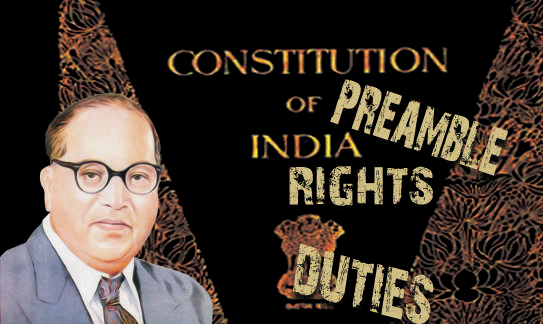

## Learning Objectives

- To know about the making of Indian Constitution.

- To know the Salient features of Indian Constitution.

- To understand the Fundamental Rights and Duties.

- To know the Directive Principles of State Policy.

- To understand the Centre-State relations and the Emergency Provisions.

## Introduction

The Constitution is the fundamental law of a country which reflects the fundamental principles on which the government of that country is based. It is the vehicle of a Nation’s progress. The concept of constitution was first originated in U.S.A.

## 1.1 The Need for a Constitution

All Democratic countries have a constitution that governs them. A constitution puts down certain principles that form the basis of any kind of a state that we as citizens, desire to live in. A constitution tells us the fundamental nature of our society.

## 1.2 Making of Indian Constitution

The Constitution of India was framed by a Constituent Assembly setup under the Cabinet Mission Plan, 1946. The Assembly consisted of 389 members representing Provinces (292), States (93), the Chief Commissioner’s provinces (3) and Baluchistan (1). The Assembly held its first meeting on December 9, 1946.

Dr. Sachchidananda Sinha, the oldest member, was elected as the temporary President of the Assembly. While the work was in progress, Dr. Sachchidananda Sinha died. Dr. Rajendra Prasad was elected as the President of the Assembly. Similarly, both H.C. Mukherjee and V.T. Krishnamachari were elected as the Vice- Presidents of the Assembly. The Assembly met for 11 sessions along with 166 days of meetings. During the discussion, 2473 amendments were presented. Some of them were accepted. The Assembly worked through various committees and the draft of the Constitution was prepared by the Drafting Committee under the chairmanship of Dr. B.R. Ambedkar. He is recognised as the ‘Father of the Constitution of India’.

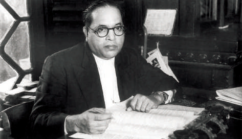

Dr. B.R. Ambedkar

After the draft had been discussed by the people, the press, provincial assemblies and others, the Constitution was finally adopted on November

26, 1949, contained a Preamble, 22 parts, 395 Articles and 8 Schedules. The drafted Constitution came into force on 26th January, 1950. This day is known as the Republic Day. It is being observed every year.

Prem Behari Narain Raizada was the calligrapher of the Indian Constitution.

The original constitution was handwritten by him in a flowing italic style.

## 1.3 Salient features of Indian Constitution

- It is the lengthiest of all the written constitutions of the world.

- It has borrowed most of its provisions from the constitutions of various countries.

- It is partly rigid and partly flexible.

- It establishes a federal system of government.

- It makes India as a secular state.

- It provides an independent judiciary.

- It introduces Universal Adult Franchise and accords the right to vote to all citizens above 18 years of age without any discrimination.

## 1.4 Preamble

The term ‘preamble’ refers to the introduction or preface to the Constitution. It consists of the ideals, objectives and basic principles of the Constitution. It has great value and has been described as the ‘key to the Constitution’.

The Preamble to the Indian Constitution is based on the ‘Objective Resolution’, drafted by Jawaharlal Nehru, which was adopted by the Constituent Assembly on January 22, 1947. It has been amended once by the 42nd Constitutional Amendment Act of 1976, which added three new words - socialist, secular and integrity. The Preamble begins with the phrase ‘We, the People of India’. Thus, we can say that the people of India are the source of our Constitution. The Preamble of our Constitution states that India is a Sovereign Socialist Secular Democratic Republic. Its aim is to secure to all Indian citizens Social, economic and political justice.

Liberty, Equality and Fraternity were the important slogans during the French Revolution in 1789. They are given importance in the Preamble of our Constitution.

## 1.5 Citizenship

The word ‘Citizen’ is derived from the Latin term ‘Civis’. It means resident of a City State. The Constitution of India provides for a single and uniform citizenship for the whole of India. Articles 5 to 11 under part II of the Constitution deals with the citizenship.

### Citizenship Act (1955)

The Citizenship Act of 1955 provides for acquisition and loss of citizenship after the commencement of the Constitution. This Act has been amended so far nine times.

### Acquisition of Citizenship

According to the Citizenship Act, 1955, the citizenship could be acquired through any of the following methods.

1. By Birth: All persons born in India on or after January 26, 1950 are treated as citizens by birth.

2. By Descent: A person born outside India on or after January 26, 1950 shall be a citizen of India by descent, if his father is a citizen of India at the time of his birth.

3. By Registration: A person can acquire citizenship of India by registration with appropriate authority.

4. By Naturalisation: A foreigners can acquire Indian citizenship, on application for naturalization to the Government of India.

5. By Incorporation of Territory: In the event of a certain territory being added to the territory of India, the Government of India shall specify the persons of that territory who shall be citizen of India.

### Loss of Citizenship

The Citizenship Act of 1955 prescribes three ways of losing citizenship whether acquired under the Act or prior to it under the Constitution, viz, renunciation, termination and deprivation.

1. It can be voluntarily renounced by a citizen.

2. It can be terminated if a person acquires the citizenship of some other country.

3. The central government can deprive a naturalized citizen, if it satisfied that the citizenship was acquired by fraud, false representation or concealment of material facts or indulges in trade with enemy countries or if the person has been sentenced to imprisonment for a period of 2 years.

## 1.6 Fundamental Rights

The Fundamental Rights are enshrined in Part III of the Constitution from Articles 12 to 35. In this regard, the framers of the Constitution derived inspiration from the Constitution of USA. Originally, the Constitution provided for seven Fundamental Rights. At present, there are only six Fundamental Rights. Part III of the Constitution is rightly described as the Magna Carta of India. While Fundamental Rights are available to all persons, certain Fundamental Rights are available only to Indian Citizens.

### Right to constitutional remedies

### (Articles - 32)

A writ is an order or command issued by a court in writing under its seal. It is in the nature of a command or prohibition from performing certain acts that are specified in the orders of the court. Both the Supreme Court and the High Courts are empowered to issue five kinds of writs. That is why the Supreme Court is called the “Guardian of the Constitution”. According to Dr. Ambedkar, Article 32 is “the heart and soul of the Constitution”.

(a) Habeas Corpus:

Safeguards people from illegal arrests. (b) Mandamus:

It protects the petitioner who requires legal help to get his work done by respective public authorities. (c) Prohibition:

It prohibits a subordinate court from acting beyond its jurisdiction. (d) Certiorari:

It quashes an order issued by a subordinate court by overstepping its jurisdiction. (e) Quo Warranto:

It prevents usurpation of public office through illegal manner.

### Suspension of Fundamental Rights

When the President makes a Proclamation of Emergency under Article 352, the freedoms guaranteed under Article 19 are automatically suspended. The President can suspend other fundamental rights through specific orders. These orders must be approved by the Parliament.

### Differences between Fundamental Rights and Directive Principles of State Policy

| Fundamental Rights | Directive Principles of State Policy |
|---|---|
| It was derived from the Constitution of the USA. | It was drawn on the model of the Constitution of Ireland. |
| Even the Government cannot take away or abridge these rights. | These are mere instructions to the Government. |
| These are enforceable by a court of law. | These are not enforceable in any court. |
| These have legal sanctions. | These have moral and political sanctions. |
| These rights strengthen political democracy in the country. | The implementation of these principles ensures social and economic democracy. |

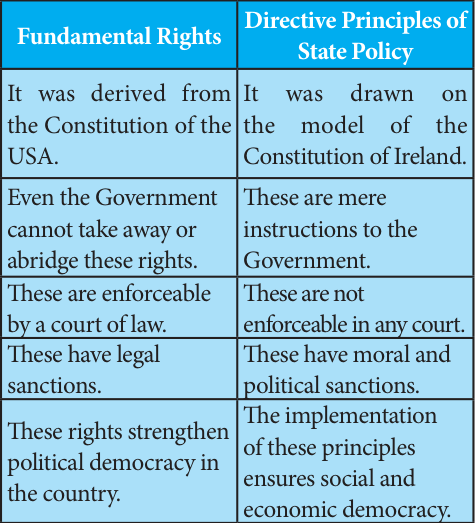

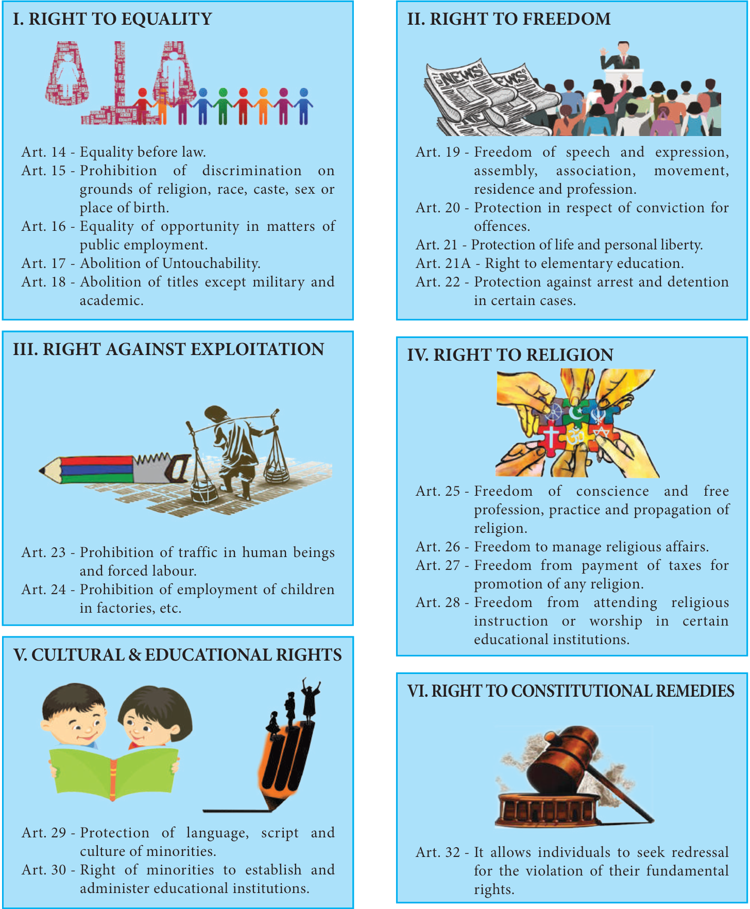

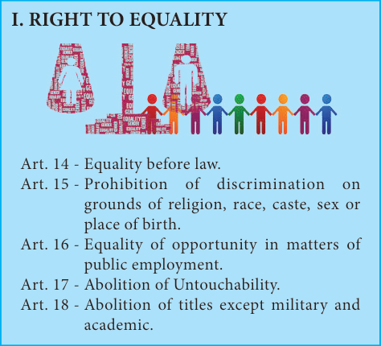

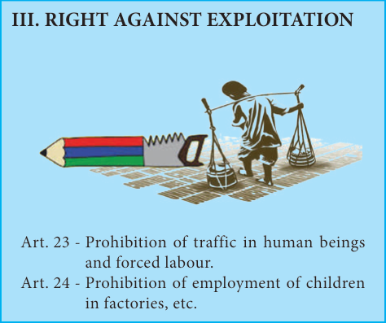

Violation of which Fundamental right is associated with the theme depicted in the stamps?

**I. RIGHT TO EQUALITY**

- Art. 14 - Equality before law.
- Art. 15 - Prohibition of discrimination on grounds of religion, race, caste, sex or place of birth.
- Art. 16 - Equality of opportunity in matters of public employment.
- Art. 17 - Abolition of Untouchability.
- Art. 18 - Abolition of titles except military and academic.

**II. RIGHT TO FREEDOM**

- Art. 19 - Freedom of speech and expression, assembly, association, movement, residence and profession.
- Art. 20 - Protection in respect of conviction for offences.
- Art. 21 - Protection of life and personal liberty.
- Art. 21A - Right to elementary education.
- Art. 22 - Protection against arrest and detention in certain cases.

**III. RIGHT AGAINST EXPLOITATION**

- Art. 23 - Prohibition of traffic in human beings and forced labour.
- Art. 24 - Prohibition of employment of children in factories, etc.

**IV. RIGHT TO RELIGION**

- Art. 25 - Freedom of conscience and free profession, practice and propagation of religion.
- Art. 26 - Freedom to manage religious affairs.
- Art. 27 - Freedom from payment of taxes for promotion of any religion.
- Art. 28 - Freedom from attending religious instruction or worship in certain educational institutions.

**V. CULTURAL & EDUCATIONAL RIGHTS**

- Art. 29 - Protection of language, script and culture of minorities.
- Art. 30 - Right of minorities to establish and administer educational institutions.

**Right to Property (Art. 31)**

was deleted from the list of Fundamental Rights by the 44th Amendment Act, 1978. It is made a legal right under Article 300-A in Part XII of the Constitution.

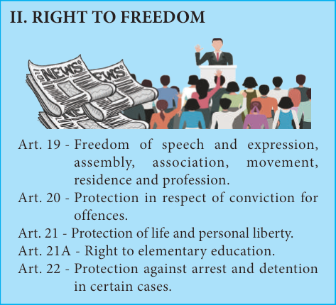

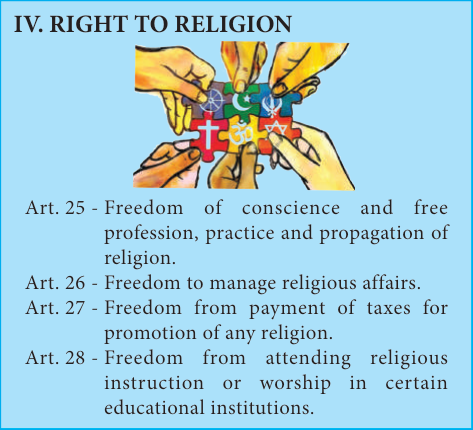

VI. RIGHT TO CONSTITUTIONAL REMEDIES

Art. 32 - It allows individuals to seek redressal for the violation of their fundamental rights.

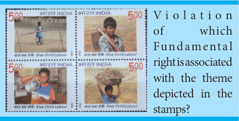

## 1.7 Directive Principles of State Policy

The Directive Principles of State Policy are enumerated in Part IV of the Constitution from Articles 36 to 51. The Constitution does not contain any classification of Directive Principles. However, on the basis of their content and direction, they can be classified into three broad categories, viz, socialistic, Gandhian and liberal-intellectual. These principles are not enforceable by the courts.

But they are fundamental for the governance of the country. They aim at promoting the Social Welfare of the people. Dr. B.R. Ambedkar described these principles as ‘novel features’ of the Indian Constitution.

The 86th Amendment Act of 2002 changed the subject -matter of Article 45 and made elementary education a fundamental right under Article 21 A. This amendment directs the state to provide early childhood care and education for all children until they complete the age of six years.

## 1.8 Fundamental Duties

The Fundamental Duties in the Indian Constitution are inspired by the Constitution of former USSR (Russia). In 1976, the Congress party set up the Sardar Swaran Singh Committee to make recommendations on fundamental duties. The 42nd Amendment Act of 1976 added some responsibilities of citizens to our Constitution called the Fundamental Duties. This amendment added a new part, namely, Part IVA to the Constitution. This new part consists of only one Article that is Article 51A which for the first time specified a code of eleven fundamental duties of the citizens.

### List of Fundamental Duties

(a) To abide by the constitution and respect its ideals and institutions, the National Flag and the National Anthem.

(b) To cherish and follow the noble ideals which inspired the national struggle for freedom

(c) To uphold and protect the s o v e r e i g n t y, unity and integrity of India (d) To defend the country and render national service when called upon to do so (e) To promote harmony and the spirit of common brotherhood among all the people of India transcending religious, linguistic and regional or sectional diversities; to renounce practices derogatory to the dignity of women (f) To value and preserve the rich heritage of our composite culture (g) To protect and improve the natural environment including forests, lakes, rivers and wildlife, and to have compassion for living creatures (h) To develop scientific temper, humanism and the spirit of inquiry and reform (i) To safeguard public property and to abjure violence (j) To strive towards excellence in all spheres of individual and collective activity, so that the nation constantly rises to higher levels of endeavour and achievement (k) To provide opportunities for education to his child or ward between the age of six and fourteen years. (The 86th Constitutional Amendment Act, 2002 has also introduced the 11th Fundamental Duty under 51A(k) under which all citizens of India or parents shall provide opportunities for education to their children between age of 6 and 14 years)

## 1.9 Centre-State Relations

### Legislative relations

The Union Parliament has the power to legislate for the whole or any part of the territory of India, which includes not only the

States but also the Union Territories or any other area for the time being, included in the territory of India. The Seventh Schedule of the Constitution embodies three lists namely, the Union List, State List and Concurrent List consisting of 97, 66 and 47 items respectively. The Parliament enjoys the exclusive power to legislate on subjects enumerated in the Union List. The State Legislature has exclusive right to legislate on the State List. Both Parliament and State Legislatures have power to legislate on subjects contained in the Concurrent. List. But in case of conflict between the law of the State and the Union on a subject in the Concurrent List, the law of Parliament prevails.

The Union List, State List and Concurrent List consisting at present 100, 61 and 52 items respectively. The 42nd Amendment Act of 1976 transferred five subjects to Concurrent List from State List, that is, education, forests, weights and measures, protection of wild animals and birds, and administration of justice; constitution and organisation of all courts excepts the Supreme Court and the high courts.

### Administrative relations

The Administrative power of a State extends only to its own territory and with respect to which it has legislative competence, whereas the Union has exclusive executive power over: (a) the matters with respect to which Parliament has exclusive power to make laws and (b) the exercise of its powers conferred by any treaty or agreement.

### Financial relations

Article 268-293 in Part XII deal with the Financial relations between centre and the states. The Centre and States are empowered by the Constitution to impose various kinds of taxes. And certain taxes are imposed and collected by the centre and divided between centre and states based on the recommendation of the Finance Commission appointed by the President under Article 280 of the Constitution.

Late Prime Minister Indira Gandhi appointed the Sarkaria Commission in 1983 to make an enquiry into the Centre-State relations. The Central government has implemented 180 (out of 247) recommendations of the Commission.

In 1969, the Tamil Nadu Government appointed a three-member committee under the chairmanship of Dr. P V Rajamannar to examine the entire question of Centre-state relations.

## 1.10 Official Language

Part XVII of the Constitution deals with the official language in Articles 343 to 351. Initially, the Constitution recognised 14 regional languages which were included in the Eighth Schedule. At present, 22 languages are recognised.

**Activity**

List out the recognised languages in the Eighth Schedule of the Constitution?

In 2004, the Government of India decided to create new category of languages called as “classical languages”. So far, the six languages are granted the classical language status namely Tamil (2004), Sanskrit (2005), Telugu (2008), Kannada (2008), Malayalam (2013) and Odia (2014).

## 1.11 Emergency Provisions

### National Emergency (Article 352)

The President under Article 352 can declare emergency if he is satisfied that India’s security is threatened due to war, external aggression or armed rebellion, or if there is an imminent danger or threat. When a national emergency is declared on the ground of war or external aggression it is known as external emergency. On the other hand, when it is declared on the ground of armed rebellion it is known as internal emergency. This type of emergency has been declared three times so far: in 1962, 1971 and 1975.

### State emergency (Article 356)

Under Article 356, the President can declare an emergency in a state if the Governor reports that a situation has arisen under which the government of a State cannot be carried on in accordance with the provisions of the Constitution. The continuance of such an emergency beyond one year is possible only if emergency under Art. 352 is in operation or the Election Commission certifies that there are difficulties in holding Assembly elections. Maximum duration of the emergency can be three years. The State is governed by the Governor on behalf of the President. For the first time, the President’s Rule was imposed in Punjab in 1951.

### Financial emergency (Article 360)

Article 360 authorises the President to declare financial emergency if he is satisfied that the financial stability or credit of India or of any of its parts is in danger. In this type of emergency, salaries and allowances of any class of persons serving State or Union, including judges of the Supreme Court and High Court can be reduced by an order of the President. This type of emergency has not been declared in India so far.

## 1.12 Amendment of the Constitution

The term amendment denotes change, improvement and modification. Article 368 of the Constitution in Part XX, deals with the powers of Parliament to amend the Constitution and its procedure.

### Procedure of Amendment

An amendment of this Constitution may be initiated only by the introduction of a Bill for the purpose in either House of Parliament, and when the Bill is passed in each House by a majority of the total membership of that House and by a majority of not less than two-thirds of the members of that House present and voting, it shall be presented to the President who shall give his assent to the Bill and thereupon the Constitution shall stand amended in accordance with the terms of the Bill. The constitution amendment can be brought about only by the Parliament. State legislatures cannot initiate for any amendment to the Constitution.

### Types of Amendments

Article 368 provides for three ways of amendments.

1. Amendment by simple majority of the

Parliament

2. Amendment by special majority of the

Parliament

3. Amendment by special majority of the

Parliament and the ratification of half of the state legislatures.

42nd amendment of the Constitution is known as the mini Constitution.

## 1.13 Constitutional Reform Commissions

The National Commission to Review the Working of the Constitution was set up by a resolution of the Government of India in 2000 headed by M.N.Venkatachaliah. In April 2007, a three member commission headed by the former Chief Justice of India M.M.Punchchi was set up by the then Government to take a fresh look at relative roles and responsibilities of various levels of Government and their inter-relations.

### SUMMARY

- The Constitution of India was framed by a Constituent Assembly set up under the Cabinet

Mission Plan, 1946.

- The Preamble of our Constitution states that India is a Sovereign, Socialist, Secular

Democratic Republic.

- The word ‘Citizen’ is derived from the Latin term ‘Civis’. It means resident of a City State.

- According to Dr. B.R. Ambedkar, Article 32 is “the heart and soul of the Constitution”.

- In 2004, the Government of India decided to create new category of languages called as

“classical languages”.

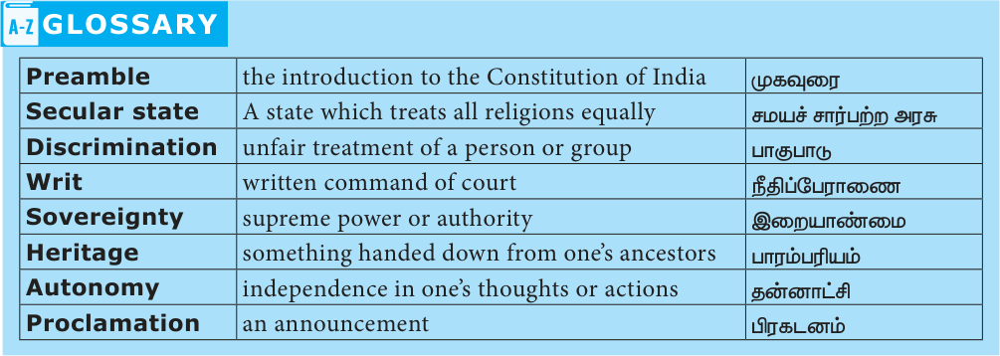

### GLOSSARY

| Term | Meaning |
|---|---|
| Preamble | the introduction to the Constitution of India |
| Secular state | A state which treats all religions equally |
| Discrimination | unfair treatment of a person or group |
| Writ | written command of court |
| Sovereignty | supreme power or authority |
| Heritage | something handed down from one’s ancestors |
| Autonomy | independence in one’s thoughts or actions |
| Proclamation | an announcement |

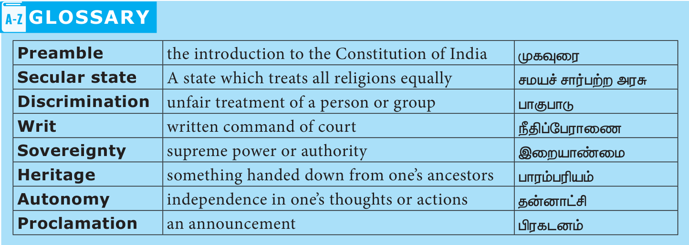

### EVALUATION

**IV Give short Answers**

1. What is a Constitution?

2. What is meant by citizenship?

3. List out the fundamental rights guaranteed by Indian Constitution.

4. What is a Writ?

5. List out the three heads of the relations between the Centre and the States.

6. What are the classical languages in India?

7. What is national emergency?

**V Answer in Detail**

1. Explain the salient features of the Constitution of India.

2. Point out the Fundamental Rights.

3. Write briefly on the Right to Constitutional Remedies.

4. Mention the differences between Fundamental Rights and Directive Principles of State Policy.

**VI Project and activity**

1. Collect information about the various members of the Constituent Assembly.

2. Collect the pictures of the Members of the Drafting Committee.

### INTERNET RESOURCES

1. https://www.india.org

2. https://legislative.gov.in/constitution-of-india

<!-- supplemental-resources:start -->

## Additional learning resources

These external resources supplement the textbook. Topic relevance was checked from provider pages or indexed creator metadata on 12–13 October 2026. Video playback, spoken language and complete coverage of every subsection have not been fully verified. Language labels identify English resources and Tamil explanations. External quiz answers have not been audited against the textbook.

### Videos

- [English-medium video catalogue — Indian Constitution](https://kalvichudarvideos.blogspot.com/p/10th-std-social-science-videos-em.html) — this lesson’s embedded video frame is present; spoken language and playback remain unverified.

- [இந்திய அரசியலமைப்பு 10th \| Indian Constitution \| Tamil](https://www.youtube.com/watch?v=LjfT-bPFwd0) — think before; Tamil explanation.
- [Making of the Indian Constitution in Tamil](https://www.youtube.com/watch?v=Z3SWTPWLiDI) — UPSC TAMIL; Tamil explanation. Covers selected concepts; see the topic table below.
- [Salient Features of the Indian Constitution — Tamil](https://www.youtube.com/watch?v=HnLmJdc-L0s) — Polity Simplified by Rangarajan - ex-IAS; Tamil explanation. Covers selected concepts; see the topic table below.
- [Preamble — Tamil](https://www.youtube.com/watch?v=MSyURYMHpP4) — Polity Simplified by Rangarajan - ex-IAS; Tamil explanation. Covers selected concepts; see the topic table below.
- [Citizenship — Tamil](https://www.youtube.com/watch?v=FR5IYw5lBHk) — Polity Simplified by Rangarajan - ex-IAS; Tamil explanation. Covers selected concepts; see the topic table below.
- [Fundamental Rights — Introduction — Tamil](https://www.youtube.com/watch?v=EIiStAN2wSs) — Polity Simplified by Rangarajan - ex-IAS; Tamil explanation. Covers selected concepts; see the topic table below.
- [Sansad TV Special: Directive Principles of State Policy — Tamil](https://www.youtube.com/watch?v=KJvDfZWPB1k) — Sansad TV; Tamil explanation. Covers selected concepts; see the topic table below.
- [Fundamental Duties of Indian Constitution](https://www.youtube.com/watch?v=EFiJpra7Las) — TAMIL WAY; Tamil explanation. Covers selected concepts; see the topic table below.
- [Centre-State Legislative Relations — Tamil](https://www.youtube.com/watch?v=M6wH8iY0oY4) — Polity Simplified by Rangarajan - ex-IAS; Tamil explanation. Covers selected concepts; see the topic table below.
- [Financial Relations between Centre and State — Tamil](https://www.youtube.com/watch?v=cZYpnGmHpNQ) — Shine Way Materials; Tamil explanation. Covers selected concepts; see the topic table below.
- [Official Languages of India in Tamil](https://www.youtube.com/watch?v=0HrfOMjf8dA) — Adda247 Tamil; Tamil explanation. Covers selected concepts; see the topic table below.
- [Emergency Provisions — Indian Polity — Tamil](https://www.youtube.com/watch?v=vWKdwGkIxNM) — Yogesh Exams; Tamil explanation. Covers selected concepts; see the topic table below.
- [Important Constitutional Amendments in Tamil — Part 1](https://www.youtube.com/watch?v=2rTBT6WUAUs) — Vimal ananthan AP; Tamil explanation. Covers selected concepts; see the topic table below.
- [National Constitution Day — Constitution significance explained in Tamil](https://www.youtube.com/watch?v=NzmWXUBztrM) — Adda247 Tamil; Tamil explanation. Covers selected concepts; see the topic table below.
- [National Commission to Review the Constitution — Indian Polity in Tamil](https://www.youtube.com/watch?v=LiylSqzo7hQ) — Yogesh Exams; Tamil explanation. Covers selected concepts; see the topic table below.

### Interactive activities

- [Indian Constitution — chapter quiz](https://wordwall.net/resource/80404739/quiz-on-indian-constitution) — Wordwall / Librarykvdnc; English. Runtime and answers have not been fully tested.

### Resources by topic

Each video below addresses the named topic or selected concepts within it. “Chapter practice” is a lesson quiz and may cover only some topics. These links do not establish complete textbook coverage.

| Textbook topic | Video | Interactive activity |
|---|---|---|
| [1.1 The Need for a Constitution](#topic-1-1) | [Topic video (Tamil explanation)](https://www.youtube.com/watch?v=NzmWXUBztrM) | [Chapter practice](https://wordwall.net/resource/80404739/quiz-on-indian-constitution) |
| [1.2 Making of Indian Constitution](#topic-1-2) | [Topic video (Tamil explanation)](https://www.youtube.com/watch?v=Z3SWTPWLiDI) | [Topic activity](https://wordwall.net/resource/80404739/quiz-on-indian-constitution) |
| [1.3 Salient features of Indian Constitution](#topic-1-3) | [Topic video (Tamil explanation)](https://www.youtube.com/watch?v=HnLmJdc-L0s) | [Chapter practice](https://wordwall.net/resource/80404739/quiz-on-indian-constitution) |
| [1.4 Preamble](#topic-1-4) | [Topic video (Tamil explanation)](https://www.youtube.com/watch?v=MSyURYMHpP4) | [Topic activity](https://wordwall.net/resource/80404739/quiz-on-indian-constitution) |
| [1.5 Citizenship](#topic-1-5) | [Topic video (Tamil explanation)](https://www.youtube.com/watch?v=FR5IYw5lBHk) | [Chapter practice](https://wordwall.net/resource/80404739/quiz-on-indian-constitution) |
| [1.6 Fundamental Rights](#topic-1-6) | [Topic video (Tamil explanation)](https://www.youtube.com/watch?v=EIiStAN2wSs) | [Topic activity](https://wordwall.net/resource/80404739/quiz-on-indian-constitution) |
| [1.7 Directive Principles of State Policy](#topic-1-7) | [Topic video (Tamil explanation)](https://www.youtube.com/watch?v=KJvDfZWPB1k) | [Chapter practice](https://wordwall.net/resource/80404739/quiz-on-indian-constitution) |
| [1.8 Fundamental Duties](#topic-1-8) | [Topic video (Tamil explanation)](https://www.youtube.com/watch?v=EFiJpra7Las) | [Chapter practice](https://wordwall.net/resource/80404739/quiz-on-indian-constitution) |
| [1.9 Centre-State Relations](#topic-1-9) | [Topic video (Tamil explanation)](https://www.youtube.com/watch?v=M6wH8iY0oY4) | [Chapter practice](https://wordwall.net/resource/80404739/quiz-on-indian-constitution) |
| [1.10 Official Language](#topic-1-10) | [Topic video (Tamil explanation)](https://www.youtube.com/watch?v=0HrfOMjf8dA) | [Chapter practice](https://wordwall.net/resource/80404739/quiz-on-indian-constitution) |
| [1.11 Emergency Provisions](#topic-1-11) | [Topic video (Tamil explanation)](https://www.youtube.com/watch?v=vWKdwGkIxNM) | [Chapter practice](https://wordwall.net/resource/80404739/quiz-on-indian-constitution) |
| [1.12 Amendment of the Constitution](#topic-1-12) | [Topic video (Tamil explanation)](https://www.youtube.com/watch?v=2rTBT6WUAUs) | [Chapter practice](https://wordwall.net/resource/80404739/quiz-on-indian-constitution) |
| [1.13 Constitutional Reform Commissions](#topic-1-13) | [Topic video (Tamil explanation)](https://www.youtube.com/watch?v=LiylSqzo7hQ) | [Chapter practice](https://wordwall.net/resource/80404739/quiz-on-indian-constitution) |

### Source-link checks

The following URLs occur in this lesson. Recent checks are shown separately from the printed source, which remains available in the original-page view. Access failures alone do not establish that a URL is broken.

| Lesson URL | Recent check | Alternative resource |
|---|---|---|
| `https://www.india.org` | Destination unrelated to this lesson | [Alternative](https://www.india.gov.in/) |
| `https://legislative.gov.in/constitution-of-india` | Page opened in recent check | [Alternative](https://www.legislative.gov.in/constitution-of-india) |

<!-- supplemental-resources:end -->

---

## Board Examination Questions

### 2 Marks

#### 2023

What are the classical languages in India ?

View Model Answer & Solution

**Classical Languages of India**
The Government of India created the status of 'Classical Language' in 2004. The officially recognized classical languages are:
1. **Tamil** (2004 - first language to be declared)
2. **Sanskrit** (2005)
3. **Telugu** (2008)
4. **Kannada** (2008)
5. **Malayalam** (2013)
6. **Odia** (2014)

---

### 5 Marks

#### 2023, 2025

Explain the salient features of the Constitution of India.

View Model Answer & Solution

**Salient Features of the Indian Constitution**
1. **Lengthiest Written Constitution:** Most comprehensive written document in the world with elaborate administrative provisions.
2. **Drawn from Diverse Sources:** Borrowed parliamentary system from the UK, Fundamental Rights from the US, Directive Principles from Ireland, and Emergency provisions from Germany.
3. **Blend of Rigidity and Flexibility:** Some provisions can be amended by a simple majority, while others require special majorities and state ratifications under Article 368.
4. **Federal System with Unitary Bias:** Division of powers between Centre and States, but strong unitary powers during emergencies.
5. **Secular and Democratic Republic:** Treats all religions equally and guarantees universal adult suffrage (right to vote above 18 years).
6. **Fundamental Rights & Duties:** Guarantees justiciable basic rights (Articles 12–35) and enlists civic duties (Article 51A).

---

#### 2024

Point out the Fundamental Rights.

View Model Answer & Solution

**Fundamental Rights Guaranteed by the Constitution of India (Part III, Articles 12–35)**
1. **Right to Equality (Articles 14–18):** Equality before the law, prohibition of discrimination, and abolition of untouchability.
2. **Right to Freedom (Articles 19–22):** Freedom of speech, assembly, movement, residence, and profession.
3. **Right against Exploitation (Articles 23–24):** Prohibition of human trafficking, forced labour, and employment of children in hazardous industries.
4. **Right to Freedom of Religion (Articles 25–28):** Freedom of conscience and free profession, practice, and propagation of religion.
5. **Cultural and Educational Rights (Articles 29–30):** Protection of language, script, and right of minorities to establish educational institutions.
6. **Right to Constitutional Remedies (Article 32):** Right to move the Supreme Court through writs (*Habeas Corpus, Mandamus, Prohibition, Quo Warranto, Certiorari*) to enforce rights.

---

#### 2026

Mention the Fundamental Rights.

View Model Answer & Solution

**Six Fundamental Rights of Indian Citizens (Part III of Constitution)**
1. **Right to Equality (Articles 14–18):** Equality before law, prohibition of discrimination, and abolition of titles and untouchability.
2. **Right to Freedom (Articles 19–22):** Guarantees freedom of speech, assembly, association, movement, residence, and profession.
3. **Right against Exploitation (Articles 23–24):** Prohibits human trafficking, forced labour (*begar*), and child labour in factories.
4. **Right to Freedom of Religion (Articles 25–28):** Freedom of conscience and to profess, practice, and propagate any religion.
5. **Cultural and Educational Rights (Articles 29–30):** Right of minorities to conserve culture and establish educational institutions.
6. **Right to Constitutional Remedies (Article 32):** Right to seek justice directly from Supreme Court for enforcement of rights through writs.

---
